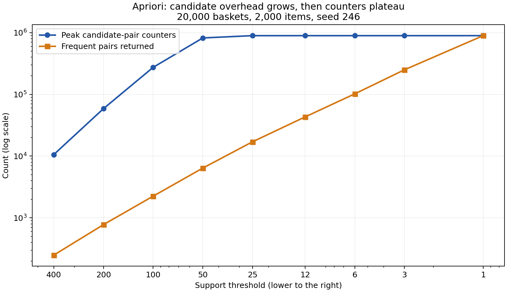

# Task 2: support, candidate counters, and practical limits

## Machine and measurement (A6)

- CPU: 12th Gen Intel(R) Core(TM) i7-1260P; Microsoft Windows 11 Home; Python 3.11.8.
- Usable RAM 15.63 GiB; available at snapshot 4.80 GiB.
- Other running processes: ChatGPT, Memory Compression, MsMpEng, chrome, explorer; snapshot 2026-10-14T15:20:15.3542166+09:00.
- Main sweep: the original 20,000 baskets, 2,000 items, seed 246 from unmodified `bench.build()`. Every support uses the same baskets and the unchanged `PlainApriori` baseline.
- Peak bytes are allocations traced during the algorithm, including pair counting and construction of its answer dictionary, but excluding the already-built input baskets, interpreter, and tracemalloc's own bookkeeping. They are not process RSS. Tracing slows these runs relative to `bench.txt`.
- Each completed row is saved immediately. The prior answer dictionary is released before the next threshold, so previous answers are not intentionally kept alive.

## Main sweep (A1, A3, A5)

| Support | Peak pair counters | Frequent pairs | Counters / answer | Seconds | Traced peak MB |
|---:|---:|---:|---:|---:|---:|
| 400 | 10,585 | 249 | 42.51 | 1.08 | 1.06 |
| 200 | 58,626 | 776 | 75.55 | 2.02 | 6.39 |
| 100 | 273,701 | 2,244 | 121.97 | 3.11 | 26.53 |
| 50 | 820,259 | 6,397 | 128.23 | 5.55 | 102.42 |
| 25 | 893,456 | 17,045 | 52.42 | 6.08 | 102.17 |
| 12 | 893,456 | 43,116 | 20.72 | 6.00 | 102.72 |
| 6 | 893,456 | 101,938 | 8.76 | 8.01 | 119.36 |
| 3 | 893,456 | 250,054 | 3.57 | 8.61 | 156.59 |
| 1 | 893,456 | 893,456 | 1.00 | 9.31 | 327.02 |

## Actual growth (A4, A5)

For support 400 -> 200 -> 100 -> 50, counters multiply by 5.54x, 4.67x, and 3.00x: substantially worse than doubling per halving. At support 50, 820,259 counters produce only 6,397 answers, a 128.2:1 ratio. Singleton filtering lets many candidate pairs through even though their joint counts are below support.

The growth does **not** continue indefinitely on this fixed dataset. From support 25 down to 1, counters plateau at 893,456, because every observed pair is already a candidate; lowering support cannot create new co-occurrences. Answers instead rise from 17,045 to 893,456 as more stored counts cross the threshold. At support 1 every observed candidate is an answer. Thus the measured curve initially has rapidly growing candidate overhead, then a plateau in counters with continued answer growth; it is not honest to claim exponential growth at every threshold.

The small non-monotonic change in peak bytes around support 50/25 reflects allocation and dictionary resizing effects, not fewer candidate pairs. At very low support, constructing the much larger returned answer dictionary increases the peak further.

## Where I stopped (A2)

The supplied dataset still completed at support 1: 9.31s and 327.02 MB of traced allocations. This did not exhaust this machine, and there is no meaningful lower positive integer support. I therefore enlarged the experiment to **10,000 items and 80,000 baskets**, retaining seed 246 and the same generator.

Before that probe, I set practical limits of **512 MiB traced allocations or 60 seconds per counting run**, checked every 128 baskets. The input is outside tracing and tracemalloc has additional overhead, so these limits leave room for the browser and other applications; they are experiment budgets, not a claim of the machine's physical RAM ceiling.

| Support | Pass-two baskets processed | Candidate counters | Seconds | Traced peak MB | Status |
|---:|---:|---:|---:|---:|---|
| 200 | 80,000 | 574,201 | 11.35 | 53.60 | completed |
| 100 | 80,000 | 1,901,132 | 17.92 | 204.73 | completed |
| 50 | 80,000 | 4,671,325 | 32.56 | 430.15 | completed |
| 25 | 66,560 | 5,597,801 | 39.28 | 817.26 | memory_budget |

The first stopped run was support **25**, at 39.28s and 817.26 MB, after 66,560/80,000 baskets in pass two: it crossed the **512 MiB traced-memory budget**. The limit is checked periodically, not enforced by the allocator; a dictionary resize can temporarily exceed it before the next check, which explains why the recorded peak is above the trigger. This is an intentional early stop, not an OS out-of-memory error. Its counters are a partial-run measurement, and its final frequent-pair count is explicitly null. The larger probe uses the same Apriori counting steps but checks the budget and does not materialize a result dictionary; its peaks should not be confused with the main sweep's complete-answer peaks.

## Reproduce

Run `python task2_explosion.py --supports 400,200,100,50,25,12,6,3,1`, then `python stress_limit.py`. The first appends to `explosion.json`; preserve the old measurement file for a fresh run. Run `python experiments.py` for rule examples, PCY byte peaks, and bucket-size comparisons, then `python write_report.py` for the reports and plot. Use `python3` where that is the Python 3 command. Plotting requires matplotlib; the required algorithms and lab checks use only the standard library.
